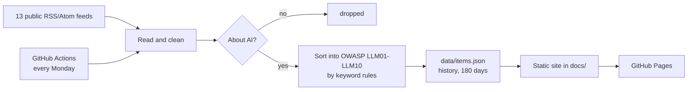

# LLM Risk Radar

A weekly digest of AI security news. It reads public news feeds, keeps the items
about AI, sorts each one into a risk from the
[OWASP Top 10 for LLM Applications (2025)](https://genai.owasp.org/llm-top-10/),
and publishes the result as a small website. It also includes a one-page sheet,
"Using AI safely" / "KI sicher nutzen", with eight everyday rules for people who
use AI assistants at work.

**Site:** see the repository's GitHub Pages link.

## How it works



1. **Read** (`radar/feeds.py`): fetches each feed in `config/feeds.toml` and keeps
   title, link, source and date. The summary is used for sorting only; the site
   shows headlines and links to the original publisher, nothing more.
2. **Filter** (`radar/classify.py`): general security feeds are kept only when an
   item mentions an AI term (whole words: "AI", "LLM", "KI", "ChatGPT", …).
3. **Sort**: each OWASP risk has a keyword list in `config/owasp.toml`, in English
   and German. The risk with the most hits wins; a hit in the title counts double,
   and so does a phrase. No hit means "Other AI security news".
4. **Store** (`radar/store.py`): items are merged into `data/items.json`, one per
   link, and dropped after 180 days.
5. **Publish** (`radar/site.py`, `radar/onepager.py`): writes plain HTML to `docs/`:
   the current week, one page per week, a trend table, the ten risks in plain
   words, and the two one-page sheets.
6. **Schedule** (`.github/workflows/weekly.yml`): GitHub Actions runs the tests
   and the update every Monday and commits the new pages.

## Why keyword rules and not an AI model

Every decision can be explained ("this headline matched *prompt injection*"),
tested, and reproduced, and it costs nothing to run. The price is accuracy: rules
miss items that describe a risk in other words, and a word like "agent" can pull
an item into the wrong group. The share of "Other" shows how much the rules don't
cover. Improving a rule means editing one line in `config/owasp.toml`.

## Run it

```bash
python3 -m venv .venv && .venv/bin/pip install -r requirements.txt
.venv/bin/python -m pytest          # 32 tests, no internet needed
.venv/bin/python -m radar update    # fetch feeds and rebuild docs/
.venv/bin/python -m radar build     # rebuild docs/ from stored data only
```

Open `docs/index.html` in a browser.

## Change it

- **Add a source:** add a `[[feed]]` block to `config/feeds.toml`. Set
  `ai_only = true` if every item of that feed is about AI security.
- **Improve the sorting:** edit the keyword lists in `config/owasp.toml`, then add
  a headline to the table in `tests/test_radar.py` so it stays sorted correctly.

## Limits

- Headlines only: it does not read or summarise the articles.
- Some sites block automated readers; those are not included.
- Sorting by keywords is approximate (see above).

## Tech

Python 3.11+ · feedparser · TOML config · pytest · GitHub Actions · GitHub Pages
